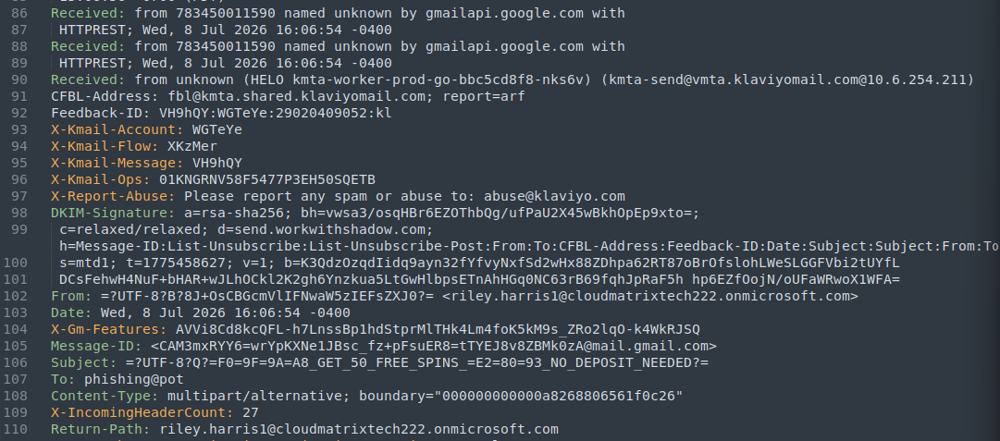
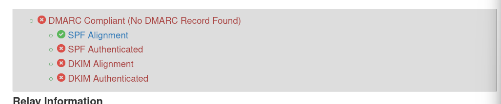
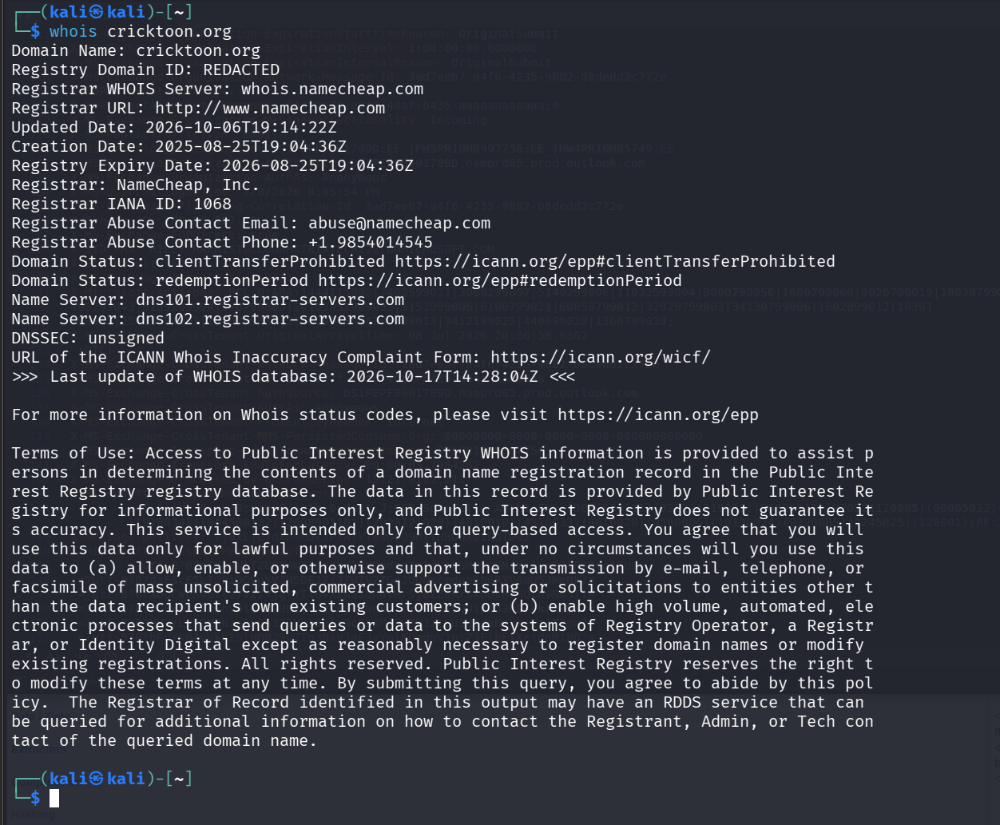
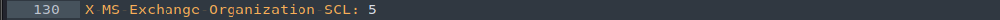
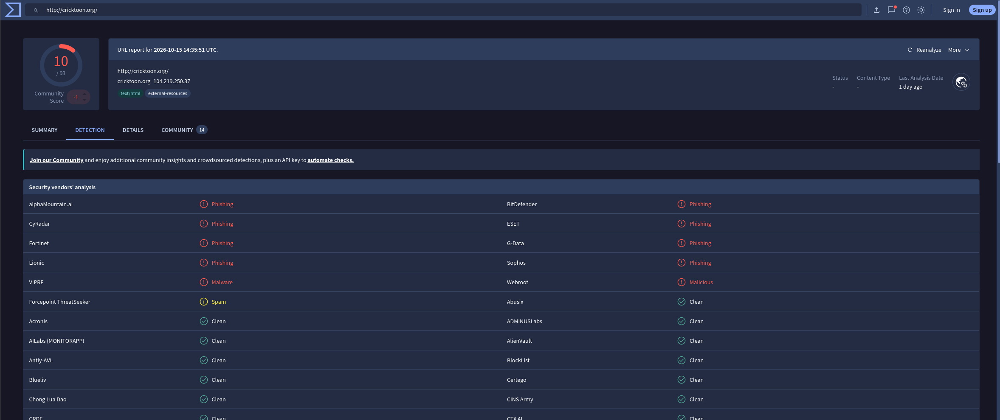

# Case 01 – "50 Free Spins" casino phishing

Sample: sample-10013.eml from [phishing_pot](https://github.com/rf-peixoto/phishing_pot)
Verdict: Malicious

## 1. Content

Subject: GET 50 FREE SPINS – NO DEPOSIT NEEDED
Display name: Free Spins Alert

Both were QP encoded in the raw file, so I decoded them first. The email wants you to click
"Set Your Email Here" and "START SPINNING". It's reward bait with all caps to create
urgency. My guess was that they want to collect email addresses.

## 2. Headers

I read the Received lines from the bottom up, since each server adds its line on top.

- From and Return-Path show a Microsoft 365 address:
  riley.harris1@cloudmatrixtech222[.]onmicrosoft[.]com
- But the email was sent through the Gmail API and handed to Microsoft by Google's server
  209.85.167.48. The Message-ID ends in @mail.gmail.com. A Microsoft address sending from
  Gmail doesn't make sense.
- The lowest Received line and the headers below it mention Klaviyo, a marketing email
  service, and the DKIM signature is for send.workwithshadow.com, which has nothing to do
  with the sender. 

## 3. SPF / DKIM / DMARC

I checked the headers with MXToolbox Header Analyzer.

- SPF: fail -the sender domain doesn't allow Google's IP to send for it
- SPF alignment: pass -see below
- DKIM: fail -the signature is for an unrelated domain
- DMARC: none the domain has no DMARC record

Alignment only checks if the domain in Return-Path is
the same as in From. Both were written by the attacker, so they match. The relevant SPF check
failed.

Microsoft also flagged it with a spam score of 5:

## 4. Domain

I checked cricktoon[.]org with whois and VirusTotal.

The domain was registered on 2025-08-25 at Namecheap and expired on 2026-08-25 without
being renewed, so it looks like a throwaway domain. It was about 10 months old when the
email was sent, so it wouldn't trigger a "newly registered domain" filter.

10/93 vendors flag it, mostly as phishing (ESET, BitDefender, Sophos, Fortinet). It
resolves to 104.219.250.37. Since the domain is already expired, I didn't scan it on
urlscan.

## 5. Things I checked and ruled out:

- 209.85.167.48 – Google's mail server
- 10.6.254.211, 10.167.18.107 – private IPs
- i[.]imgur[.]com – normal image host

## 6. Conclusion

It's phishing. The sender is fake (Microsoft 365 address sent through Gmail), SPF, DKIM
and DMARC fail and every link goes to a domain that 10 vendors flag as phishing.

If this hit a real company, I would:

1. Block cricktoon[.]org and the sender
2. Search the mail logs and delete all copies
3. If someone entered data, tell them and watch the account

